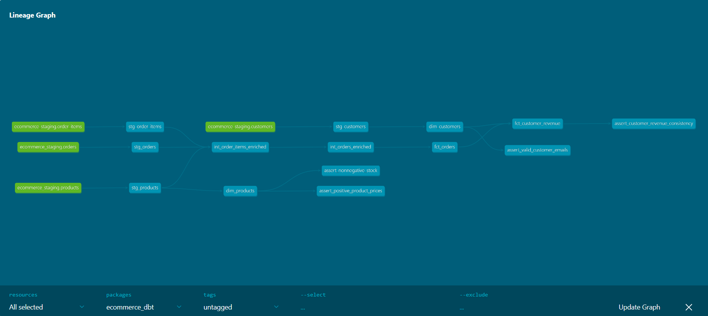
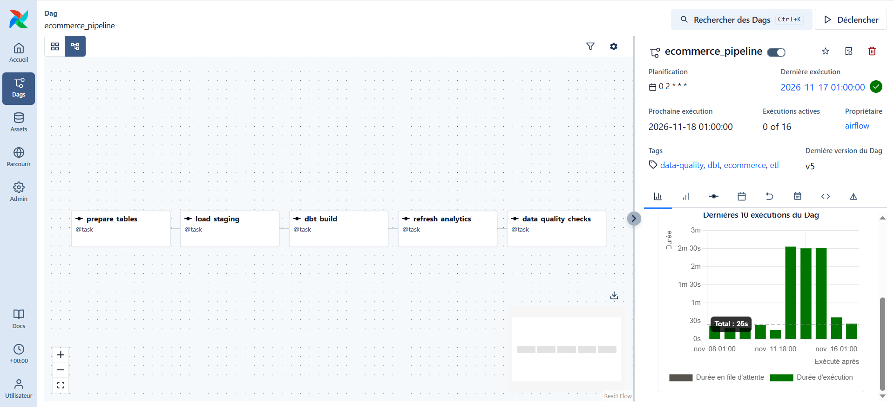
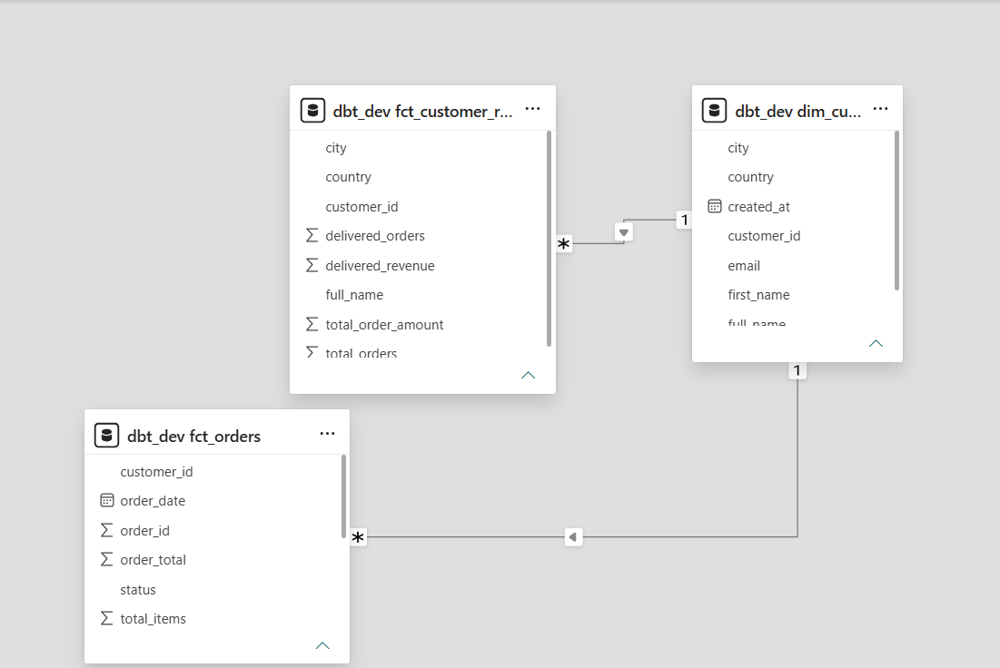
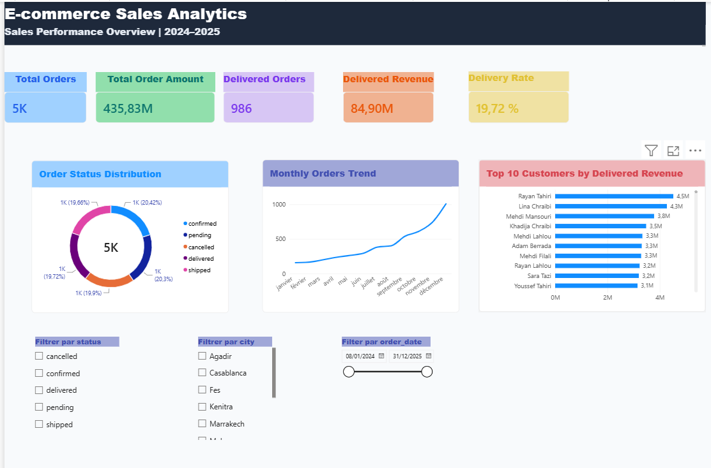
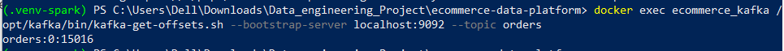
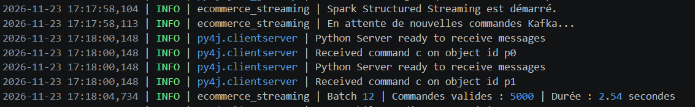
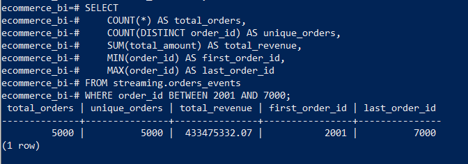
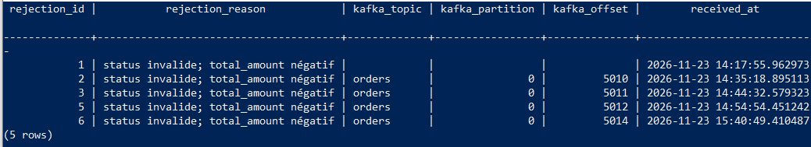
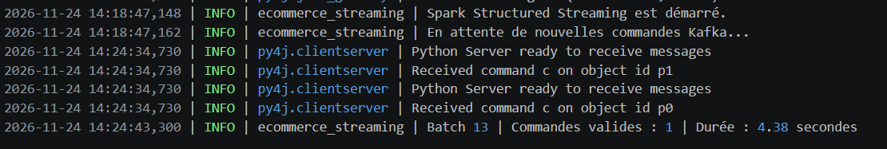

# E-commerce Data Engineering Platform

An end-to-end Data Engineering project that builds an e-commerce data platform using Python, PostgreSQL, Apache Airflow, dbt, Apache Kafka, Spark Structured Streaming, Docker and Power BI.

The platform ingests raw CSV data, validates and transforms records, builds analytical models, processes real-time events, runs automated data quality tests and provides business insights through an interactive Power BI dashboard.

---

## Table of Contents

- [Project Overview](#project-overview)
- [Business Objectives](#business-objectives)
- [Architecture](#architecture)
- [Technology Stack](#technology-stack)
- [Dataset](#dataset)
- [Data Pipeline](#data-pipeline)
- [Data Warehouse Design](#data-warehouse-design)
- [Python Ingestion and Validation](#python-ingestion-and-validation)
- [SQL and dbt Transformations](#sql-and-dbt-transformations)
- [Data Quality and Testing](#data-quality-and-testing)
- [Apache Airflow Orchestration](#apache-airflow-orchestration)
- [Power BI Dashboard](#power-bi-dashboard)
- [Real-Time Data Engineering – Streaming Pipeline](#real-time-data-engineering--streaming-pipeline)
- [Project Structure](#project-structure)
- [Installation and Setup](#installation-and-setup)
- [Running the Pipeline](#running-the-pipeline)
- [Environment Variables](#environment-variables)
- [Results](#results)
- [Security](#security)
- [Roadmap](#roadmap)
- [Project Status](#project-status)
- [Author](#author)

---

## Project Overview

The goal of this project is to develop a complete e-commerce data platform that transforms raw operational data into reliable analytical datasets.

The platform combines two processing approaches:

- **Batch Processing:** Python, PostgreSQL, dbt and Apache Airflow.
- **Real-Time Streaming:** Python, Apache Kafka and Spark Structured Streaming.

The batch pipeline follows a layered data architecture:

- **RAW:** Stores ingested source data.
- **STAGING:** Contains cleaned and validated data.
- **DBT Analytical Layer:** Implements SQL transformations and analytical models.
- **POWER BI:** Provides interactive dashboards for business analysis.

The project uses a synthetic e-commerce dataset to simulate an operational environment and demonstrate data processing, analytics and streaming capabilities.

## Business Objectives

The platform supports business analysis through questions such as:

- How many orders were placed?
- What is the total value of orders?
- How many orders were delivered, cancelled or are still pending?
- Which customers generate the highest delivered revenue?
- How does order activity evolve over time?
- How do sales and order volumes vary by customer location?
- What is the distribution of orders by status?

The streaming component additionally demonstrates how order events can be processed and validated as they arrive.

## Architecture

### Batch Processing Architecture

```text
                  SYNTHETIC CSV DATA
                         |
                         v
              PYTHON INGESTION LAYER
              - CSV ingestion
              - Data validation
              - Error handling
                         |
                         v
                    POSTGRESQL
                         |
              +----------+----------+
              |                     |
              v                     v
          RAW SCHEMA           REJECTED DATA
              |
              v
        STAGING SCHEMA
        - Data cleaning
        - Standardization
        - Referential checks
              |
              v
             DBT
        - Staging models
        - Intermediate models
        - Analytical models
        - Data tests
              |
              v
          DBT_DEV SCHEMA
              |
              v
           POWER BI
        - KPI reporting
        - Customer analysis
        - Order analysis
        - Interactive filters

         APACHE AIRFLOW
       Orchestrates pipeline tasks
```



### Real-Time Streaming Architecture

```text
CSV Orders and Order Items
          |
          v
    Python Producer
          |
          v
      Apache Kafka
       (orders)
          |
          v
Spark Structured Streaming
          |
     +----+----+
     |         |
     v         v
Valid Events  Rejected Events
     |         |
     v         v
PostgreSQL Streaming Schema
```

## Technology Stack

| Technology | Purpose |
|---|---|
| Python 3.12 | Data ingestion, validation and event production |
| PostgreSQL 16 | Relational database and data warehouse |
| SQL | Data querying and transformations |
| Docker | Service containerization |
| Docker Compose | Local environment management |
| Apache Airflow 3.3.2 | Batch pipeline orchestration |
| dbt Core 1.12.6 | SQL transformations and data testing |
| dbt-postgres 1.11.0 | PostgreSQL adapter for dbt |
| Apache Kafka 4.1.1 | Real-time event streaming |
| PySpark 4.0.1 | Structured Streaming and event processing |
| kafka-python | Python Kafka producer |
| PostgreSQL JDBC Driver 42.7.7 | Spark-to-PostgreSQL connectivity |
| pytest | Automated testing |
| GitHub Actions | Continuous Integration |
| Power BI Desktop | Data visualization and reporting |
| Git and GitHub | Version control and project hosting |

## Dataset

The project uses a deterministic synthetic e-commerce dataset generated with Python.

The generator is located at:

`scripts/generate_dataset.py`

The generated CSV files are stored in:

`data/generated/`

### Dataset Statistics

| Entity | Number of records |
|---|---:|
| Customers | 1,000 |
| Products | 100 |
| Orders | 5,000 |
| Order Items | 20,017 |
| **Total** | **26,117** |

**Date range:** January 2024 – December 2025.

The dataset contains customer information, product details, orders and order items.

The generator uses a fixed random seed to make the dataset reproducible.

The original sample data in `data/raw/` is preserved separately from the larger generated dataset.

## Data Pipeline

### 1. Data Generation

The script `scripts/generate_dataset.py` generates synthetic customer, product, order and order-item records.

### 2. Data Ingestion

Python scripts load CSV records into PostgreSQL.

The ingestion layer handles:

- CSV reading;
- Record validation;
- Database insertion;
- Duplicate handling;
- Rejected record management;
- Repeatable loading through conflict handling.

### 3. RAW Layer

The RAW schema stores the ingested source records.

### 4. STAGING Layer

The STAGING schema contains prepared data:

- Normalized emails and text fields;
- Cleaned product and customer information;
- Standardized order statuses;
- Validated quantities and prices;
- Checked relationships between customers, orders and products.

### 5. dbt Transformations

dbt transforms staging data into analytical models using SQL.

### 6. Power BI

Power BI connects to PostgreSQL and consumes analytical views for reporting and business analysis.

## Data Warehouse Design

The project uses three main data layers.

### RAW

Stores the data ingested from CSV files.

### STAGING

Contains cleaned and standardized data prepared by Python.

### DBT Analytical Layer

Contains the dbt models in the `dbt_dev` schema.

The dbt models are organized into three groups:

| Layer | Models | Purpose |
|---|---|---|
| Staging | `stg_customers`, `stg_orders`, `stg_products`, `stg_order_items` | Standardize source data |
| Intermediate | `int_order_items_enriched`, `int_orders_enriched` | Join and aggregate business data |
| Marts | `dim_customers`, `dim_products`, `fct_orders`, `fct_customer_revenue` | Provide analytical datasets |

The project currently uses views for its 10 dbt models.

### Data Modeling Concepts

- `source()` references upstream PostgreSQL staging tables.
- `ref()` defines dependencies between dbt models.
- Customer and product dimensions provide descriptive information.
- Fact models provide order and revenue metrics.

## Python Ingestion and Validation

Python is responsible for loading and validating source records.

Main ingestion scripts include:

- `src/ingestion/load_customers.py`
- `src/ingestion/load_products.py`
- `src/ingestion/load_orders.py`
- `src/ingestion/load_order_items.py`

The ingestion process includes validation rules such as:

- Missing or invalid email addresses;
- Invalid dates;
- Duplicate identifiers;
- Invalid quantities;
- Negative prices;
- Missing customer references;
- Missing product or order references.

Rejected records are stored separately for inspection instead of being silently discarded.

## SQL and dbt Transformations

dbt manages the analytical SQL transformations.

### Staging Models

- `stg_customers`
- `stg_orders`
- `stg_products`
- `stg_order_items`

### Intermediate Models

`int_order_items_enriched` joins order items with orders and products to calculate line totals.

`int_orders_enriched` aggregates order items to calculate order-level metrics.

### Analytical Models

- `dim_customers`: Customer dimension.
- `dim_products`: Product dimension.
- `fct_orders`: Order-level analytical facts.
- `fct_customer_revenue`: Customer-level revenue metrics.

### Example: Order Line Calculation

```sql
oi.quantity * oi.unit_price AS line_total
```

### Example: Order Aggregation

```sql
SELECT
    order_id,
    customer_id,
    order_date,
    status,
    COUNT(order_item_id) AS total_items,
    SUM(line_total) AS order_total
FROM {{ ref('int_order_items_enriched') }}
GROUP BY
    order_id,
    customer_id,
    order_date,
    status
```

## Data Quality and Testing

Data quality is validated at different levels.

### dbt Lineage Graph

The following graph illustrates the dependencies between source tables, staging models, intermediate models and analytical models.


### Python Tests with pytest

The original project test suite contains 11 tests:

| Test Category | Number of Tests |
|---|---:|
| Data Quality | 7 |
| Pipeline Errors | 2 |
| PostgreSQL Integration | 2 |
| **Total** | **11** |

The PostgreSQL integration tests include:

- Database connectivity;
- Temporary table operations;
- Idempotence of analytical loading.

The test database `ecommerce_test` is separated from the main development database.

Run the tests with:

```bash
python -m pytest -v
```

### dbt Data Tests

The dbt project contains:

- 10 models;
- 29 data tests;
- 4 declared sources.

The tests cover data integrity and business rules, including uniqueness, null values, accepted values, relationships and custom validation rules.

Run the dbt project with:

```bash
dbt build --project-dir dbt/ecommerce_dbt
```

**Latest recorded dbt build result:**

```text
PASS=39
WARN=0
ERROR=0
SKIP=0
TOTAL=39
```

This corresponds to 10 models and 29 tests.

## Apache Airflow Orchestration

Apache Airflow orchestrates the main data pipeline through the DAG:

`airflow/dags/ecommerce_pipeline.py`

The DAG contains the following tasks:

| Task | Responsibility |
|---|---|
| `prepare_tables` | Prepare database tables |
| `load_staging` | Load staging data |
| `dbt_build` | Execute dbt transformations and tests |
| `refresh_analytics` | Refresh analytical data |
| `data_quality_checks` | Run data quality checks |

### Scheduling Configuration

- Schedule: Daily at 02:00.
- Timezone: `Africa/Casablanca`.
- `catchup=False`.
- Retries: 2.
- Retry delay: 2 minutes.
- Task execution timeout: 15 minutes.

The retry behavior was tested using a temporary DAG designed to fail deliberately. The test confirmed that two retries result in three total attempts.

The main DAG was previously executed successfully in the original project environment. The complete Airflow workflow still requires final end-to-end validation against the enlarged `ecommerce_bi` dataset.

### Airflow DAG

The DAG below illustrates the tasks and dependencies involved in the pipeline orchestration.



## Power BI Dashboard

The project includes an interactive Power BI dashboard:

**E-commerce Sales Analytics Dashboard**

Power BI connects to PostgreSQL and imports the following analytical views:

- `fct_orders`
- `fct_customer_revenue`
- `dim_customers`
- `dim_products`

### Data Model Relationships

The customer dimension is connected to the order and customer revenue fact views through `customer_id`.

The model uses one-to-many relationships with single-direction filtering.

### Key Performance Indicators

The dashboard includes the following measures:

| KPI | Description |
|---|---|
| Total Orders | Number of distinct orders |
| Total Order Amount | Total value of all orders |
| Delivered Orders | Number of delivered orders |
| Delivered Revenue | Value of delivered orders |
| Revenue by Status | Order value respecting the selected status |

### Example DAX Measures

**Total Orders**

```dax
Total Orders =
DISTINCTCOUNT(fct_orders[order_id])
```

**Total Order Amount**

```dax
Total Order Amount =
SUM(fct_orders[order_total])
```

**Delivered Orders**

```dax
Delivered Orders =
CALCULATE(
    DISTINCTCOUNT(fct_orders[order_id]),
    fct_orders[status] = "delivered"
)
```

**Delivered Revenue**

```dax
Delivered Revenue =
CALCULATE(
    SUM(fct_orders[order_total]),
    fct_orders[status] = "delivered"
)
```

**Revenue by Status**

```dax
Revenue by Status =
SUM(fct_orders[order_total])
```

### Power BI Data Model



### Dashboard Visuals

The dashboard includes:

- KPI cards;
- Order distribution by status;
- Monthly order trends;
- Top 10 customers by revenue;
- Interactive status filter;
- Customer city filter;
- Order date range filter.

The customer city slicer uses `dim_customers[city]` to ensure correct filter propagation through the customer dimension.

### Dashboard Validation

The following functional checks were performed:

- KPI values checked without filters;
- Status filter tested;
- City filter tested;
- Date range filter tested;
- Top 10 customer chart tested with different order statuses;
- Combined filters tested;
- Filter reset behavior tested.

The dashboard responded correctly during these functional checks.

The Power BI dashboard file is maintained separately as a `.pbix` file.

### Dashboard Preview



## Real-Time Data Engineering – Streaming Pipeline

This project also includes a real-time data engineering pipeline designed to process e-commerce order events using Apache Kafka and Spark Structured Streaming.

### Technologies

- Python;
- Apache Kafka 4.1.1;
- PySpark 4.0.1;
- PostgreSQL 16;
- Docker;
- kafka-python;
- PostgreSQL JDBC Driver.

### Key Features

- Read order data from CSV files.
- Calculate order totals using Python and Decimal.
- Publish order events as JSON messages to Kafka.
- Process events in real time with Spark Structured Streaming.
- Validate incoming events and separate valid from rejected records.
- Store valid and rejected events in PostgreSQL.
- Track Kafka topic, partition and offset metadata.
- Use Spark checkpoints to support stream recovery.
- Log batch processing metrics and execution duration.
- Use PostgreSQL UPSERT operations to prevent duplicate order records.

### Streaming Validation Results

| Metric | Result |
|---|---:|
| Processed order events | 5,000 |
| Unique orders | 5,000 |
| Total revenue | 433,475,332.07 |
| First order ID | 2001 |
| Last order ID | 7000 |

An additional test event (`order_id = 9001`) was used to verify stream restart behavior. It is excluded from the results above.

The duplicate event processing test also confirmed database-level idempotency: processing the same order IDs again did not create duplicate records in PostgreSQL.

### Execution Evidence

**Kafka Topic**



**Spark Structured Streaming**



**PostgreSQL Results**



**Rejected Events**



**Spark Restart Test**



For implementation details, validation rules and execution procedures, see the [Streaming Pipeline Documentation](docs/streaming.md).

## Project Structure

```text
ecommerce-data-engineering-platform/
│
├── airflow/
│   └── dags/
│       └── ecommerce_pipeline.py
│
├── data/
│   ├── raw/
│   └── generated/
│
├── dbt/
│   └── ecommerce_dbt/
│       ├── models/
│       │   ├── staging/
│       │   ├── intermediate/
│       │   └── marts/
│       ├── tests/
│       └── dbt_project.yml
│
├── scripts/
│   └── generate_dataset.py
│
├── src/
│   ├── ingestion/
│   ├── database/
│   └── streaming/
│       ├── producer.py
│       ├── consumer.py
│       ├── spark_structured_streaming.py
│       ├── send_test_event.py
│       ├── send_invalid_test_event.py
│       ├── spark_aggregation_test.py
│       ├── spark_dataframe_test.py
│       ├── spark_kafka_test.py
│       └── spark_test.py
│
├── tests/
│   ├── integration/
│   ├── conftest.py
│   ├── test_data_quality.py
│   └── test_pipeline_errors.py
│
├── .github/
│   └── workflows/
│       └── tests.yml
│
├── docs/
│   ├── images/
│   └── streaming.md
│
├── docker-compose.yml
├── requirements.txt
├── .env.example
├── .gitignore
└── README.md
```

*The structure above highlights the main project components. Some generated data, local configuration, checkpoints, logs and virtual environments are intentionally excluded from version control.*

## Installation and Setup

### Prerequisites

Install the following tools:

- Python 3.12 for the batch pipeline;
- Python 3.11 for the local Spark environment;
- Docker Desktop and Docker Compose;
- Git;
- PostgreSQL client tools (optional);
- dbt Core and dbt-postgres;
- Apache Airflow 3.3.2;
- Java 17 for the local Spark environment;
- Power BI Desktop for dashboard analysis.

### 1. Clone the Repository

```bash
git clone https://github.com/Meryemeilla/ecommerce-data-engineering-platform.git

cd ecommerce-data-engineering-platform
```

### 2. Create a Virtual Environment

Windows PowerShell:

```powershell
python -m venv .venv

.\.venv\Scripts\Activate.ps1
```

### 3. Install Dependencies

```powershell
python -m pip install -r requirements.txt
```

### 4. Configure Environment Variables

Copy the example environment file:

```powershell
Copy-Item .env.example .env
```

Update the database credentials in `.env`.

### 5. Start PostgreSQL and Kafka

```powershell
docker compose up -d
```

### 6. Configure dbt

Configure the dbt profile in:

```text
%USERPROFILE%\.dbt\profiles.yml
```

The dbt profile must point to the PostgreSQL database and the appropriate schema.

Validate the connection:

```powershell
dbt debug --project-dir dbt/ecommerce_dbt
```

## Running the Pipeline

The commands below describe the main stages of the local batch workflow. Use the scripts and module names present in the repository.

### 1. Generate the Synthetic Dataset

```powershell
python scripts/generate_dataset.py
```

### 2. Configure the BI Dataset

For the generated dataset, set the environment variables in PowerShell:

```powershell
$env:DB_NAME = "ecommerce_bi"
$env:DATA_DIR = "data/generated"
```

These variables apply to the current PowerShell session.

### 3. Prepare Database Tables

Execute the database setup scripts to create the RAW, rejected-record and STAGING tables.

### 4. Ingest CSV Data

Run the Python ingestion scripts for customers, products, orders and order items.

### 5. Load Staging Data

Run the staging loading scripts to populate the staging schema.

### 6. Build dbt Models and Run Tests

```powershell
dbt build --project-dir dbt/ecommerce_dbt
```

### 7. Generate dbt Documentation

```powershell
dbt docs generate --project-dir dbt/ecommerce_dbt
```

To view the documentation locally:

```powershell
dbt docs serve --project-dir dbt/ecommerce_dbt
```

### 8. Run Python Tests

```powershell
python -m pytest -v
```

### 9. Run the Streaming Pipeline

The streaming implementation uses a separate local Spark environment and Kafka configuration.

Refer to [Streaming Pipeline Documentation](docs/streaming.md) for the producer, Spark Structured Streaming, checkpoint and PostgreSQL execution procedures.

### 10. Open the Power BI Dashboard

Connect Power BI Desktop to the PostgreSQL database and select the analytical views in the `dbt_dev` schema.

## Environment Variables

The project uses environment variables for database configuration.

Typical development and test variables include:

```env
DB_HOST=localhost
DB_PORT=5433
DB_NAME=ecommerce
DB_USER=ecommerce_user
DB_PASSWORD=your_password

DATA_DIR=data/raw

TEST_DB_HOST=localhost
TEST_DB_PORT=5433
TEST_DB_NAME=ecommerce_test
TEST_DB_USER=ecommerce_user
TEST_DB_PASSWORD=your_test_password
```

The actual `.env` file must remain local and must never be committed.

The BI environment uses the `ecommerce_bi` database and the `data/generated` directory.

The streaming pipeline uses the same PostgreSQL connection configuration, together with Kafka and Spark-specific settings documented in `docs/streaming.md`.

## Results

### Generated Dataset

- 1,000 customers;
- 100 products;
- 5,000 orders;
- 20,017 order items.

### Data Quality

The generated dataset was validated for:

- Missing customer references;
- Missing order references;
- Missing product references;
- Invalid quantities;
- Negative prices;
- Invalid email formatting.

The staging checks returned no issues for the tested conditions.

### Analytical Results

The following values were obtained from the enlarged BI dataset:

| Metric | Result |
|---|---:|
| Total orders | 5,000 |
| Total order amount | 435,827,074.36 |
| Delivered orders | 986 |
| Cancelled orders | 995 |
| Confirmed orders | 1,021 |
| Pending orders | 1,015 |
| Shipped orders | 983 |

**Important:** Total Order Amount includes orders across all statuses. Delivered Revenue only includes delivered orders. These metrics should not be interpreted as equivalent to collected cash or accounting revenue.

### Streaming Results

The streaming pipeline processed 5,000 order events and stored 5,000 unique orders in PostgreSQL.

The total streaming order amount was 433,475,332.07 for order IDs 2001–7000.

The additional test event `order_id = 9001` is excluded from these figures.

### Testing Results

- 11 Python tests passed in the original test suite.
- 29 dbt data tests passed in the latest recorded dbt build.
- The latest recorded dbt build completed with 39 successful resources (10 models and 29 tests).
- Streaming validation and duplicate-event processing tests were performed.
- Power BI functional filter and KPI checks were successful.

## Security

- Never commit `.env` files.
- Do not publish database passwords or credentials.
- Use `.env.example` to document required variables without real secrets.
- Keep local database configuration separate from source code.
- Use dedicated databases for development, testing and BI experimentation.
- Keep virtual environments, Spark checkpoints and local logs out of version control.

## Roadmap

- [x] Build Python CSV ingestion scripts.
- [x] Create PostgreSQL RAW and STAGING layers.
- [x] Implement data validation and rejected-record handling.
- [x] Develop SQL transformations.
- [x] Integrate dbt models and data tests.
- [x] Create a synthetic dataset for BI analysis.
- [x] Add automated Python tests.
- [x] Configure GitHub Actions for CI.
- [x] Build the Power BI dashboard.
- [x] Validate dashboard KPIs and interactive filters.
- [x] Implement Kafka-based event production.
- [x] Implement Spark Structured Streaming.
- [x] Store valid and rejected events in PostgreSQL.
- [x] Add streaming checkpoints and processing logs.
- [x] Document the streaming pipeline.
- [ ] Perform final end-to-end Airflow validation with the enlarged BI dataset.
- [ ] Improve monitoring and pipeline observability.
- [ ] Add incremental dbt models.
- [ ] Improve deployment configuration.

---

## Project Status

**Portfolio project – actively developed.**

This project demonstrates practical Data Engineering skills across batch and streaming architectures, including Python ingestion, PostgreSQL data modeling, SQL transformations, dbt testing, Airflow orchestration, Kafka event streaming, Spark Structured Streaming, CI automation and Power BI reporting.

## Author

**Meryeme**

[GitHub Repository](https://github.com/Meryemeilla/ecommerce-data-engineering-platform)