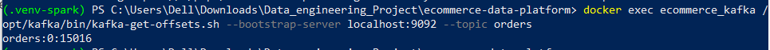
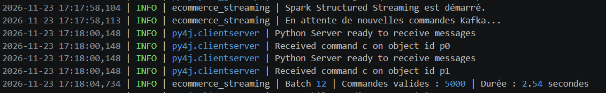
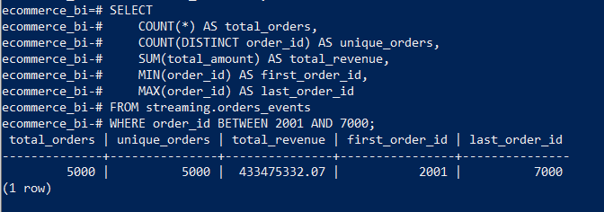
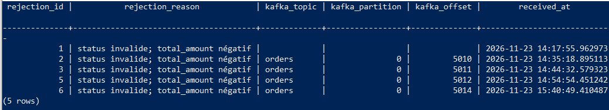
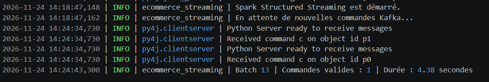

# Real-Time Data Pipeline – Kafka & Spark Structured Streaming

## 1. Overview

The E-commerce Data Engineering Platform includes a real-time data processing pipeline built with Apache Kafka, PySpark Structured Streaming and PostgreSQL.

The streaming pipeline processes e-commerce order events, validates incoming data, separates valid and rejected records, and stores the results in PostgreSQL.

Unlike the batch pipeline, which processes historical CSV datasets, the streaming pipeline consumes events continuously from Kafka.

## 2. Architecture

```text
orders.csv + order_items.csv
          |
          v
   Python Kafka Producer
          |
          v
   Apache Kafka
      Topic: orders
          |
          v
   Spark Structured Streaming
          |
          v
    JSON Parsing
          |
          v
    Data Validation
          |
     +----+----+
     |         |
     v         v
 Valid      Rejected
 Events     Events
     |         |
     v         v
 PostgreSQL  PostgreSQL
 streaming.  streaming.
 orders_     rejected_order_
 events      events
```

## 3. Technologies

- Python
- Apache Kafka 4.1.1
- PySpark 4.0.1
- PostgreSQL 16
- Docker and Docker Compose
- kafka-python
- psycopg2

## 4. Data Production

The Python producer reads two CSV files:

- `orders.csv`
- `order_items.csv`

It calculates each order's total amount by aggregating its order items:

`total_amount = SUM(quantity * unit_price)`

Python's `Decimal` type is used during monetary calculations to reduce floating-point rounding errors.

Each event is serialized as JSON and published to the Kafka topic `orders`.

Example event:

```json
{
  "order_id": 2001,
  "customer_id": 28,
  "status": "delivered",
  "total_amount": 108923.58
}
```

## 5. Stream Processing

Spark Structured Streaming consumes events from the Kafka topic.

The processing steps include:

1. Reading Kafka messages.
2. Extracting event values and Kafka metadata.
3. Parsing JSON payloads.
4. Normalizing order statuses.
5. Applying data validation rules.
6. Separating valid and rejected events.
7. Writing results to PostgreSQL.

Kafka metadata is retained to support event traceability:

- Topic
- Partition
- Offset

## 6. Data Quality Rules

Events are rejected when one or more of the following conditions are detected:

- Missing order ID.
- Missing customer ID.
- Missing or empty status.
- Invalid order status.
- Missing total amount.
- Negative total amount.

Accepted statuses:

- `pending`
- `confirmed`
- `shipped`
- `delivered`
- `cancelled`

Rejected events are stored with their original JSON payload and rejection reason.

## 7. PostgreSQL Storage

The streaming pipeline uses two tables.

### Valid events

`streaming.orders_events`

Stores validated order events, including their Kafka metadata and processing timestamp.

The `order_id` primary key and PostgreSQL upsert operation prevent duplicate order rows when an existing order is processed again.

### Rejected events

`streaming.rejected_order_events`

Stores rejected events with:

- Original JSON payload
- Rejection reason
- Received timestamp
- Kafka topic
- Kafka partition
- Kafka offset

A unique constraint on available Kafka metadata prevents duplicate rejected-event records for the same topic, partition and offset.

## 8. Checkpointing and Restart

Spark Structured Streaming uses persistent checkpoint directories to maintain processing progress:

- `data/checkpoints/kafka_orders_valid`
- `data/checkpoints/kafka_orders_rejected`

These checkpoints are reused when restarting the streaming application.

The pipeline was restarted using its existing checkpoints, and subsequent test events were processed successfully.

## 9. Logging and Monitoring

The application uses Python logging to record:

- Streaming application startup.
- Batch processing information.
- Number of valid events.
- Number of rejected events.
- Batch processing duration.

Log file:

`logs/spark_streaming.log`

Example:

```text
Batch 12 | Commandes valides : 5000 | Durée : 2.54 secondes
```

## 10. Validation Results

The producer successfully published 5,000 new order events to Kafka.

Spark Structured Streaming processed all 5,000 events as valid records.

PostgreSQL verification:

| Metric | Result |
|---|---:|
| Processed orders | 5,000 |
| Unique order IDs | 5,000 |
| First order ID | 2,001 |
| Last order ID | 7,000 |
| Total order revenue | 433,475,332.07 |

Rejected-event verification:

| Metric | Result |
|---|---:|
| Rejected rows in PostgreSQL | 5 |
| Unique events with Kafka metadata | 4 |

The rejected records include historical test events. One older test record was inserted before Kafka metadata was added, which explains the difference between the two counts.

### Duplicate Event Processing Test

The producer was executed a second time, publishing the same 5,000 order IDs to Kafka.

Spark consumed the new events, with Kafka offsets ranging from 10,016 to 15,015.

PostgreSQL verification confirmed:

- 5,000 order records.
- 5,000 unique order IDs.
- No duplicate order rows after reprocessing.

This demonstrates database-level idempotency through PostgreSQL UPSERT operations when the same order IDs are processed again.

## 11. Important Implementation Notes

- Monetary values are aggregated using Python `Decimal` before JSON serialization.
- Spark uses separate checkpoints for valid and rejected event processing.
- PostgreSQL upserts protect valid order records against duplicate order IDs.
- Rejected events are identifiable through Kafka metadata when available.
- These mechanisms provide database-level duplicate protection; they do not establish end-to-end exactly-once processing guarantees.

## 12. Screenshots and Execution Evidence

### 12.1 Kafka Topic

The Kafka topic `orders` receives order events produced by the Python application.



### 12.2 Spark Structured Streaming

Spark consumes Kafka events, validates the incoming data and processes valid and rejected records.



### 12.3 PostgreSQL Storage

The validated streaming events are stored in PostgreSQL. The demonstration processed 5,000 unique orders.



### 12.4 Rejected Events

Invalid events are stored separately with their rejection reasons and Kafka metadata.



### 12.5 Spark Restart

This screenshot documents a Spark restart and the processing of a new Kafka event using the existing checkpoint configuration.


